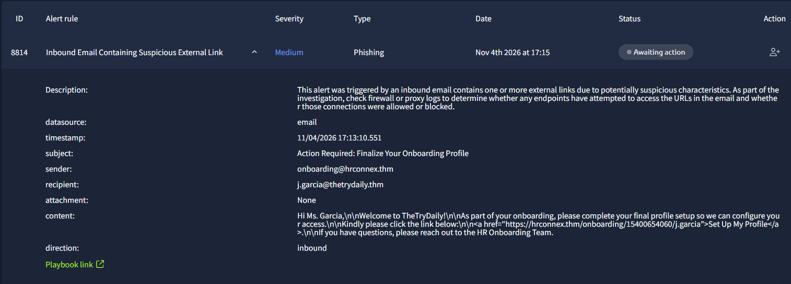
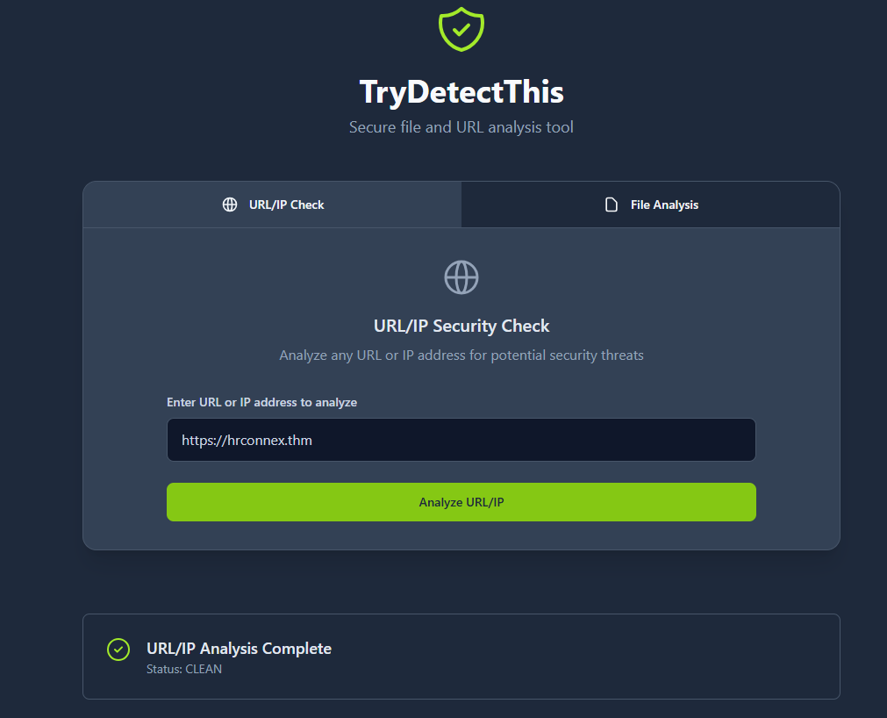

# CASE-01 - Phishing Email Investigation Report

* Alert Name: Inbound Email containing suspicious external link 
* Severity: Medium
* Status: Closed
* Investigation type: Phishing
* Environment: SOC Simulated Lab
* Investigation Date: 11/04/2026

### Email Authentication: 
- SPF: Not provided in telemetry.
- DKIM: Not provided in telemetry.
- DMARC: Not provided in telemetry.

Investigation Limitation: The simulated environment did not provide the email header information, or email 
authentication results to prove SPF, DKIM, and DMARC data.

## 1. Who
### User Related Entities
* User: Julia Garcia
* Email: j.garcia@thetrydaily.thm
* Device Name: Win-3452
* Source IP: 10.20.2.8

### IOCs related entities
* Sender Email: onboarding@hrconnex.thm
* URL: https://hrconnex.thm/onboarding/15400654060/j.garcia
* Domain: @hrconnex.thm

## 2. What
What caused the event to be triggered and investigated
### Event
* Inbound email containing a suspicious URL triggered the alert
* Alert indicated, email might have suspicious characteristics
* Stated that firewall and proxy logs need to be checked to determine if access to the URL was granted

### Alert
* SIEM Logs indicated connection to URL was allowed

### Activity Observed
* No suspicious activity

## 3. When
Document relevant timestamps
* Alert Generated: Nov 4th 2026 at 17:15
* First Observed: Nov 4th 2026 17:16
* Last Observed: Nov 4th 2026 17:30
* Investigation Period: 17:10 - 17:40

## 4. Where
Identify systems, locations, and services involved
* Source System: Win-3452
* Destination: Website redirection
* Network: External
* Port and Protocol: N/A
* Log Source: N/A

## 5. Supporting information and evidence
* No Malicious attachment found in the email
* No suspicious or urgent wording found in the body or subject
* Email subject states "Action Required: Finalize Your Onboarding Profile"
* Body context indicates:
   - Welcoming message to the user "Hi Mrs Garcia, Welcome to TheTryDaily! As Part of your onboarding final profile setup ..."
   - Instructs user to click link to finalize setup of profile
* Provided URL has a clean Reputation on THM checker.
* URL contains the domain of the alleged company
* Provided domain returns as clean on reputation checker
* Sender's Domain corresponds to the alleged company domain

### Evidence
* Email alert evidence:  
  

* URL Reputation THM Checker for alleged company domain:  
  

## 6. Verdict
Fale Positive

## 7. Why
There's no malicious activity present in the email classified as Phishing. Based on the evidence and supporting information above the email is classified as a False Positive. 
