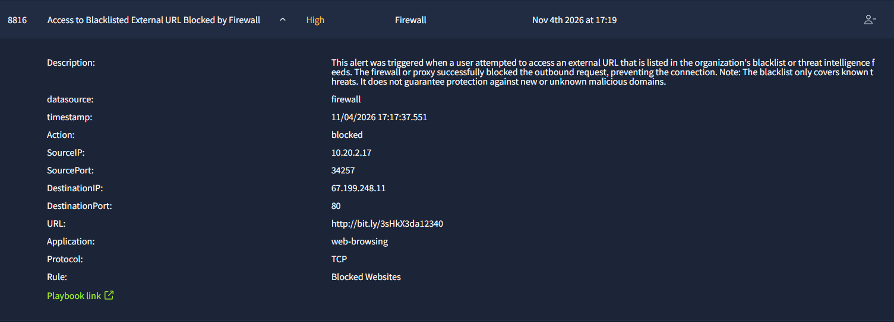
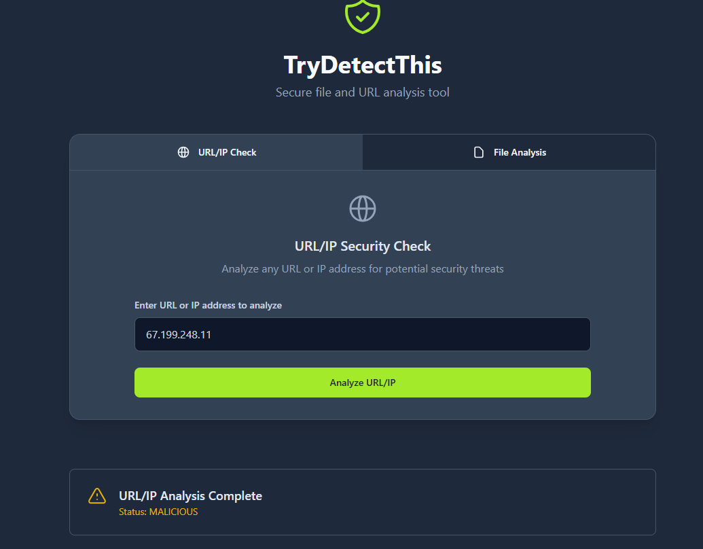
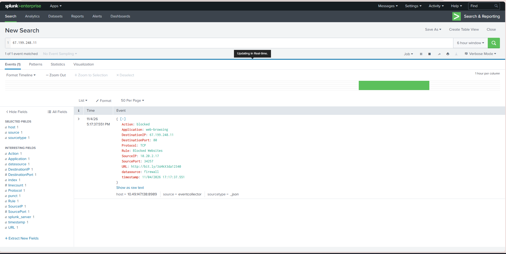
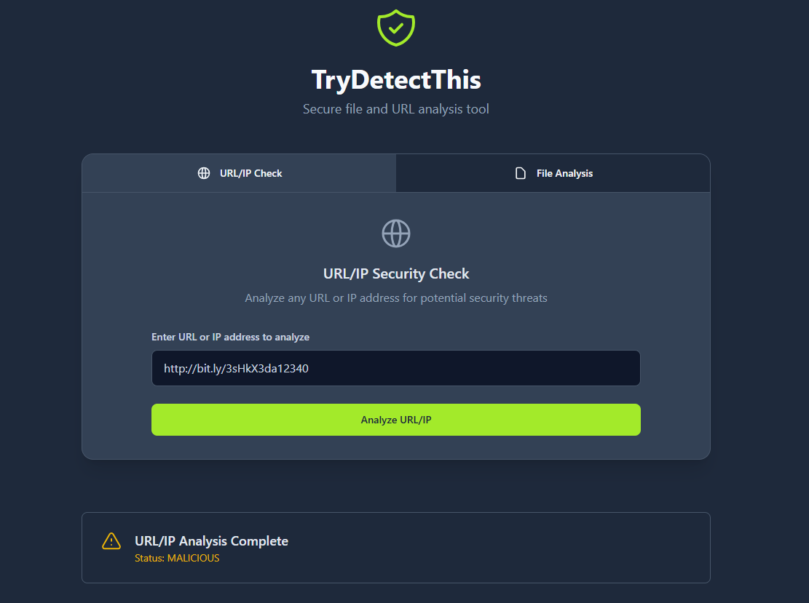

# Case-02 - Firewall Investigation Report

* Alert Name: Access to blacklisted external URL blocked by firewall
* Severity: High
* Status: Closed
* Investigation Type: Firewall
* Environment Type: SOC Simulation Lab
* Investigation Date: 11/04/2026

## 1. Who
### User Related Entities
* User: Hannah Harris
* Device Name: Win-3457
* Email: h.harris@thetrydaily.thm
* Source IP: 10.20.2.17

### IOCs Related Entities
* URL: http://bit.ly/3sHkX3da12340
* Destination IP: 67.199.248.11
* Destination Port: 80

## 2. What
What caused the event to be triggered and investigated
### Event
* Triggered, when user attempted to access a blacklisted URL (http://bit.ly/3sHkX3da12340)
* Indicated, firewall successfully blocked access

### Alert & Activity Observed
* Firewall successfully blocked access to the URL and IP
* Another SIEM Log contained similar URL and IP - was associated to the same user (Hannah Harris) - for Email Phishing

## 3. When
Document relevant timestamps
* Alert Generated: Nov 4th 2026 17:19
* First Observed: Nov 4th 2026 17:31
* Last Observed: Nov 4th 2026 18:14
* Investigation Period: 17:19 - 18:14

## 4. Where
Identify systems, locations, and services involved
* Source System: Win-3457
* Destination: Website redirection
* Network: External
* Port and Protocol: TCP/80
* Log Source: SIEM

## 5. Supporting information & Evidence
* Destination 67.199.248.11 IP returns a malicious rating on Reputation Checker
* Target URL http://bit.ly/3sHkX3da12340 returns a malicious rating on Reputation Checker - indicates Malicious URL Redirection

### Evidence
* Firewall alert evidence:
  
* Reputation checker evidence for IP address:
  
* SIEM Log evidence:
  
* Reputation Checker evidence for URL:
  

## 6. Verdict
True Positive

## 7. Why
* User accessed a blacklsited URL
* Destination IP and URL returns a malicious rating
* SIEM indicated another log contained the same URL and IP

## 8. Escalation
NO, according to SIEM, the firewall successfully blocked access and, based on SIEM logs the IP and URL has no other ongoing traction. 

## 9. Recommended Remediation Action
* Notify the user regarding phishing risk and best practices
* Determine if anything was downloaded
* Determine if the user was redirected to another page (Landing Page)

  
