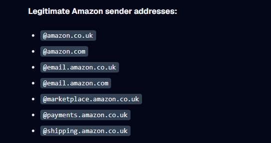
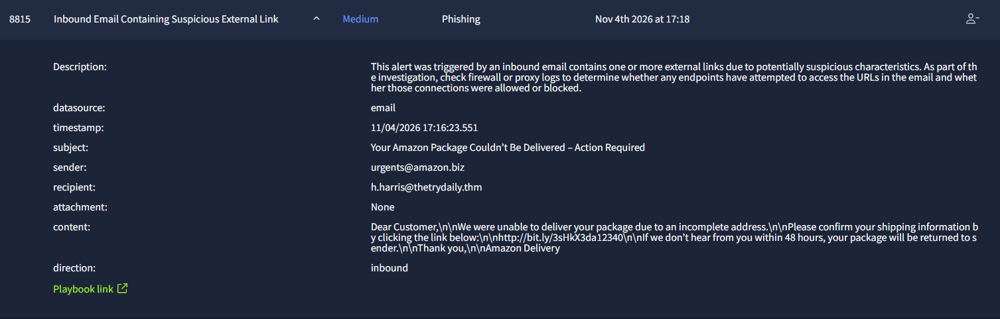
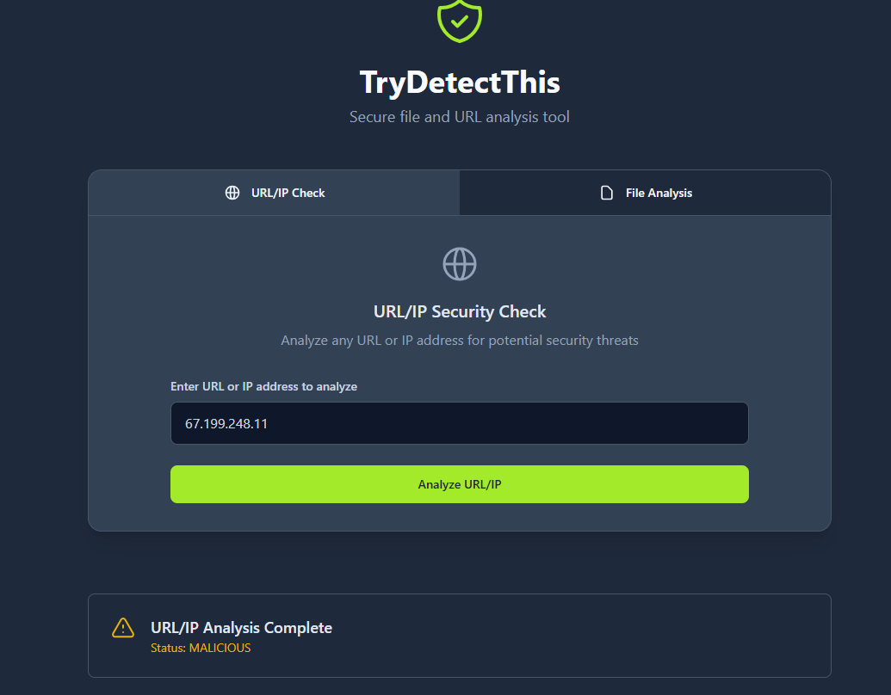
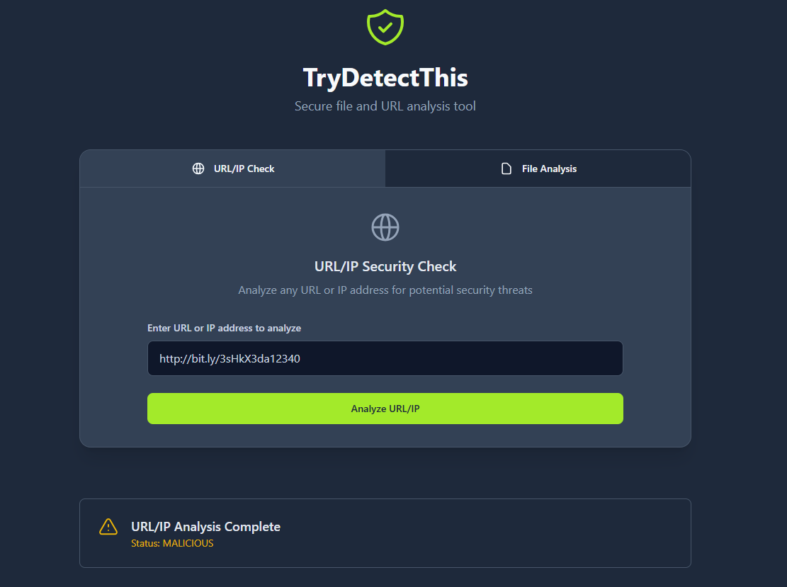
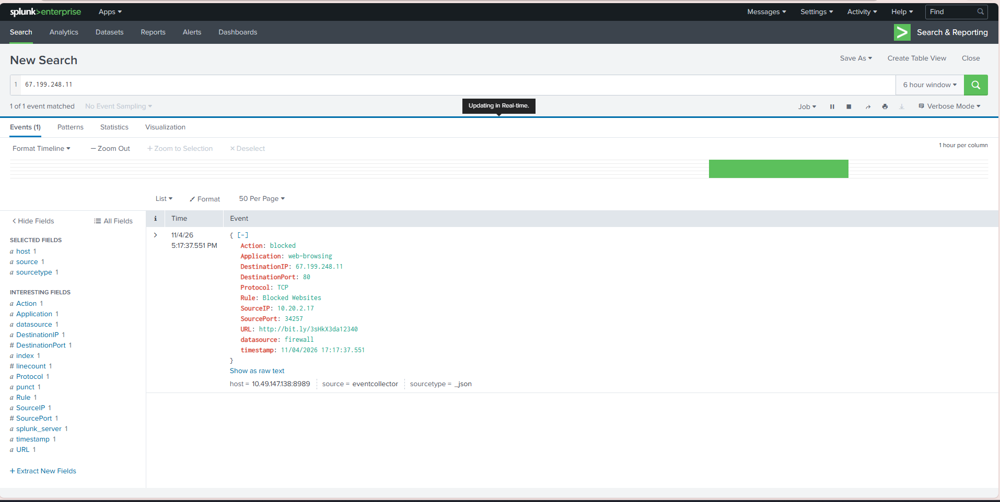

# Case-03 - Email Phishing Investigation Report

* Alert Name: Inbound Email Containing Suspicious External Link
* Severity: Medium
* Status: Closed
* Environment Type: SOC Simulated Lab
* Investigation Type: Phishing Email
* Investigation Date: 11/04/2026

### Email Authentication
* SPF: Not provided in telemetry.
* DKIM: Not provided in telemetry.
* DMARC: Not provided in telemetry.

Investigation Limitation: The simulated environment did not provide the email header information, or email authentication results to prove SPF, DKIM, and DMARC data.

## 1. Who
### User Related Entities
* User: Hannah Harris
* Device Name: Win-3457
* email: h.harris@thetrydaily.thm
* Source IP: 10.20.2.17
  
### IOCs Related Entities
* URL: https://bit.ly/3sHkX3da12340
* Sender's Email: urgents@amazon.biz
* Destination IP: 67.199.248.11

## 2. What
What caused the event to be triggered and investigated
### Event
* Inbound email contained a suspicious link
* Email - labelled as a potential Phishing activity
* Instructed to check firewall and proxy logs to determine if connection was granted or blocked

### Alert & Activity Observed
* SIEM logs indicate URL & IP was successfully blocked
* Another SIEM log contains similar URL and IP associated with user (Hannah Harris) - for Firewall Case 

## 3. When
Document relevant timestamps
* Alert Generated: Nov 4th 2026 17:18
* First Observed: Nov 4th 2026 18:15
* Last Observed: Nov 4th 2026  19:00
* Investigation Period: 18:15 - 19:00

## 4. Where
Identify systems, locations, and services involved
* Source System: Win-3457
* Network: External
* Destination: Website Redirection
* Port & Protocol: TCP/80
* Log Source: SIEM

## 5. Supporting Information & Evidence
* No Attachment to email
* Email body and subject contain urgency characteristics
* Sender claims to be Amazon (urgents@amazon.biz) - indicates Brand Impersonation
* Sender's Email domain does not match according to AMAZON legitimate domain practice:
  
* URL does not contain the alleged company's domain - indicates Malicious URL Redirection
* Subject context indicates:
  - Amazon Package could not be delivered
  - Urgency phrasing "Action Required"
  - This indicates the sender claims to be Amazon Delivery Support
* Body context indicates:
  - Formal greeting to user "Dear Customer, We were unable to deliver your package due to an incomplete address ..."
  - Instructs user to click provided link (https://bit.ly/3sHkX3da12340) to update information - this indicates Personal Information Harvesting
  - Body context contains urgency characteristics such as time contraint "If we don't hear from you within 48 hours" and fea-of-loss "..package will be returned to sender."
* URL https://bit.ly/3sHkX3da12340 returns a malicious rating on Reputation Checker
* Destination IP 67.199.248.11 returns a malicious rating on Reputaion Checker

### Evidence
* Amazon phishing email alert evidence
  
* reputation checker evidence for IP
  
* URL Reputation checker for URL
  
* SIEM Log evidence
  

## 6. Verdict
True Positive

## 7. Why
Both the URL and IP associated with the inbound email returns a malicious status. There are various social engineering characteristics in the email such as time contraints, fear-of-loss, and urgency. Therefore, based on the supporting information, evidence, and above mentioned reason, it's clear the inbound email Hanna Harris recieved is True Positive.

## 8. Escalation
No. According to the SIEM Logs, URL and IP were successfully blocked

## 9. Recommended Remediation Action
* Inform User regarding Phishing risk and best practices
* Determine if user accessed the link, and if they were redirected to a page (Landing Page)
* Determine if anything was downloaded when the user clicked the link
  
