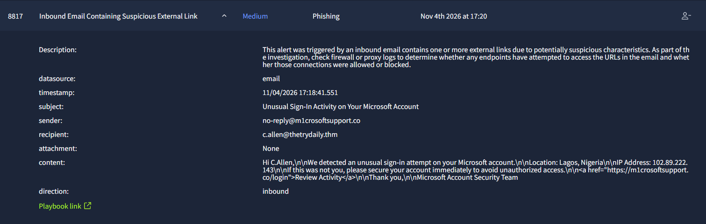
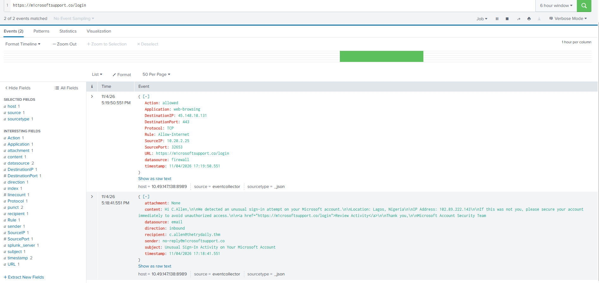
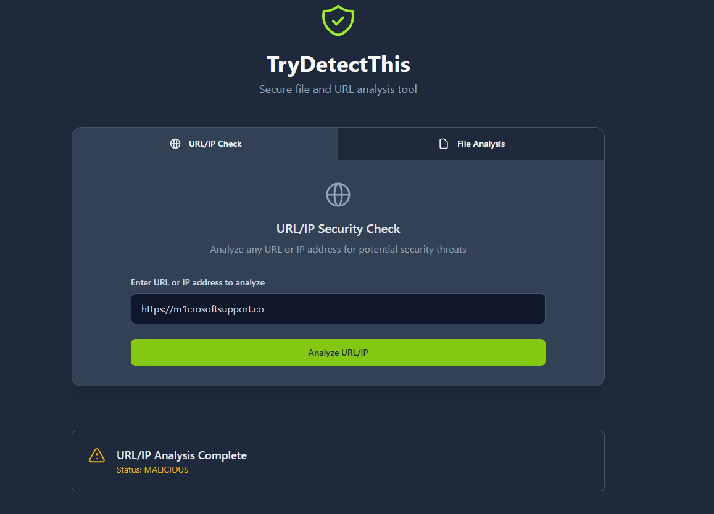
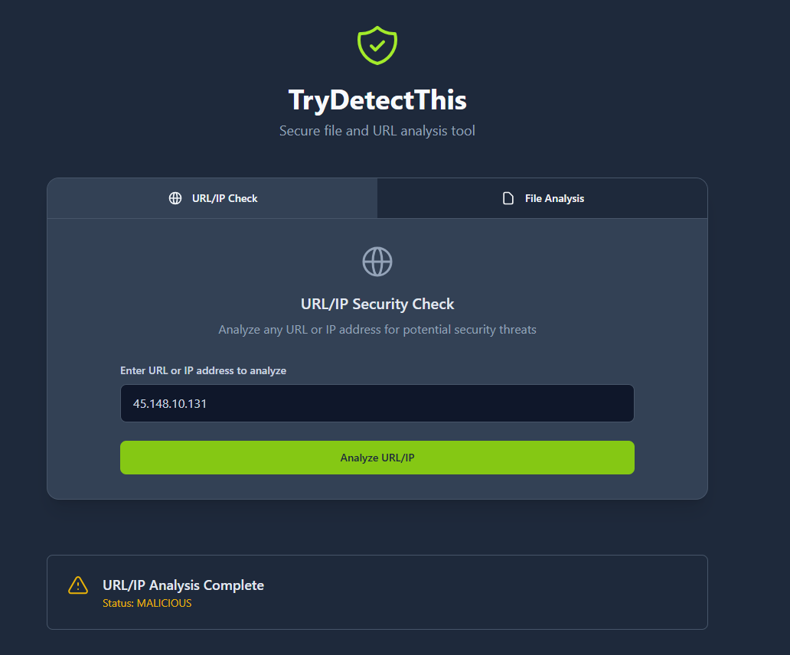

# Case-04 - Phishing Email Investigation Report

* Alert Name: Inbound Email Containing Suspicious External Link
* Severity: Medium
* Status: In Process
* Investigation Type: Phishing
* Environment Type: SOC Simulated Lab
* Investigation Period: 11/04/2026

### Email Authentication
* SPF: Not provided in telemetry.
* DKIM: Not provided in telemetry.
* DMARC: Not provided in telemetry.

Investigation Limitation: The simulated environment did not provide the email header information, or email authentication results to prove SPF, DKIM, and DMARC data.

## 1. Who
### User Related Entities
* User: Charlotte Allen
* Device Name: Win-3463
* Source IP: 10.20.2.25
* Email: c.allen@thetrydaily.thm

### IOCs Related Entities
* Sender Email: no-reply@m1crosoftsupport.co
* URL: https://m1crosoftsupport/login
* Destination IP: 45.148.10.131

## 2. What
What caused the event to be triggered and investigated

### Event
* Inbound email contains suspicious links and triggered an alert
* Instructed to check firewall and proxy logs to determine if URL access connection was blocked

### Alert & Activity Observed
* SIEM logs state firewall allowed access
* Remote server 45.148.10.131 communicated with user's device (Win-3463)

## 3. When
Document relevant timestamps
* Alert Generated: Nov 4th 2026 17:20
* First Observed: Nov 4th 2026 21:08
* Last Observed: Nov 4th 2026 21:45
* Investigation Period: 21:08 - 21:45

## 4. Where
* Source System: Win-3463
* Destination: Website redirection
* Network: External
* Port & Protocol: TCP/443
* Log Source: SIEM

## 5. Supporting Information and Evidence
* No Attachment present in email
* Both body and subject contain social engineering characteristics
* Sender's email (no-reply@m1crosoftsupport.co) indicates typosquating - evident that it's Brand Domain Impersonation
* Subject context Analysis:
  - States user (Charlotte Allen) has unusual sign-in activity on Microsoft account
* Body Context Analysis:
  - Welcoming message to user "Hi C.Allen, We detected an unusual sign-in attempt on your Microsoft account ..."
  - Contains social engineering characteristics such as location "Lagos, Nigeria" and IP Address "102.89.222.143" - this indicates panic or fear-of-loss
  - Instructs user to click link (https://m1crosoftsupport/login) to Review Activity
  - Sender claims to be affiliated with Microsoft Account Security Team
  - Malicious URL (https://m1crosoftsupport/login) indicates URL Redirection and Credential Harvesting
* Both the URL and Destination IP (45.148.10.131) returns a malicious rating on Reputation Checker

### Evidence
* Microsoft Phishing Email Alert Evidence
  
* Alleged Microsoft SIEM Log Evidence Proving firewall allowed access
  
* Alleged Microsoft Domain Reputation Checker Evidence
  
* Alleged Microsoft IP Address Reputation Checker Evidence
  

## 6. Verdict
True Positive

## 7. Why
The email contains elements of social engineering, and the sender's email domain does not correspond to alleged company's (Microsoft) email domain. Furthermore, the sender's email domain contains a typo related to typosquating (no-reply@m1crosoftsupport.co), which indicates brand domain impersonation. Moreover, the provided supporting evidence and information indicates the email is classified as True Positive.

## 8. Escalation
Yes. According to SIEM logs, firewall allowed user to access URL, and connection was established to destination IP. This indicates, user's Mircosoft credentials has been harvested, and the user (Charlotte Allen) device (Win-3463) has compromises. This requires deeper investigation to determine scope of impact and compromises. 

Escalate: SOC L2 Analyst

## Recommended Remediation Action
* Containment of device (Win-3463)
* Block malicious URL (https://m1crosoftsupport/login) and IP Address (45.148.10.131)
* Reset user's Microsoft credentials
* Investigate scope of impact and compromises
* Inform user of phishing risk and best practices
* Investigate device to determine if anything was download or if user was redirected to a landing page
* Investigate to determine if other devices are affected based on this Microsoft Acoount Breach

